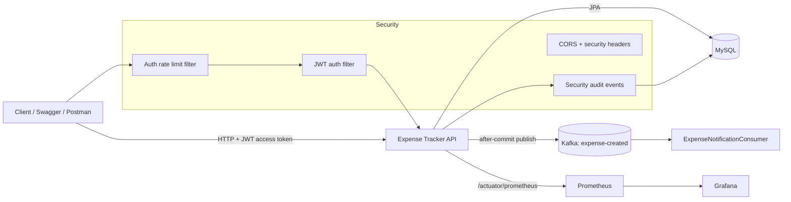

<!-- Copyright (c) 2026 Harsh (git4harsh). All rights reserved. -->
# Architecture Notes

## System overview

## Request flow
1. **Rate limiting:** auth requests (`/api/auth/**`) pass through an in-memory per-IP window limiter (429 on excess).
2. **Authentication:** `JwtAuthFilter` validates Bearer access tokens and establishes the authenticated principal (email).
3. **Authorization & hardening:** Spring Security enforces route access, stateless sessions, CORS policy, and security headers.
4. **Validation & handling:** controllers validate DTOs/query params and delegate to services; `ApiExceptionHandler` returns structured error responses and correlation IDs are propagated via `CorrelationIdFilter`.
5. **Business logic:** services enforce owner-scoped access before reading/mutating user data.
6. **Persistence:** Spring Data JPA repositories persist users, categories, expenses, refresh tokens, and audit events in MySQL.

## Authentication and token lifecycle
- **Access tokens:** short-lived JWTs used for API authorization.
- **Refresh tokens:** opaque, long-lived tokens stored server-side as hashes with expiry/revocation/rotation metadata.
- **Rotation:** refresh exchanges revoke the presented token and issue a new pair; revoked-token reuse triggers protective revocation of active tokens for the user.
- **Logout:** revoke a specific refresh token or all active tokens for the authenticated user.
- **Auditing:** security-relevant actions (register/login/refresh/logout, profile/password changes) are recorded as audit events. Password reset is not yet implemented; future reset flows should emit auditable request/verification/completion/failure events.

## Expense-created event flow
1. `ExpenseService` saves the expense within a database transaction.
2. It publishes an in-process Spring application event.
3. `ExpenseEventForwarder` listens after transaction commit and sends the event to Kafka topic `expense-created`.
4. `ExpenseNotificationConsumer` consumes the event and writes a notification log entry.

This is a demonstration event flow (at-least-once semantics not fully guaranteed). For production reliability, consider a transactional outbox, idempotent consumers, retries, and dead-letter topics.

## Observability
- Logback/SLF4J emits application logs with correlation context.
- `CorrelationIdFilter` accepts or generates `X-Correlation-Id`, returns it to callers, and places it in MDC.
- Actuator exposes health/info and Prometheus metrics.
- Prometheus scrapes the API (`/actuator/prometheus`).
- Grafana provisions datasources/dashboards for visualization.

## Data ownership and query safety
- Expense, category, and profile operations are scoped to the authenticated owner.
- Expense listing supports validated filters, pagination bounds, and whitelisted sorting to prevent unsafe/unbounded queries.

## Runtime topology (Docker Compose)
- `app` (Spring Boot API), `mysql`, `kafka` (dual listeners for host and container access), `prometheus`, and `grafana` run as Compose services.
- Profiles/config (`application.yml`, `application-docker.yml`, `application-local.yml`) and `.env.example` support reproducible local/container execution.

## Related docs
- [README.md](README.md) — setup, demo, CI/quality gates
- [API.md](API.md) — endpoint contracts and usage
- [docs/ER_DIAGRAM.md](docs/ER_DIAGRAM.md) — data model
- [docs/DESIGN_AND_ROADMAP.md](docs/DESIGN_AND_ROADMAP.md) — decisions, trade-offs, limitations, roadmap
