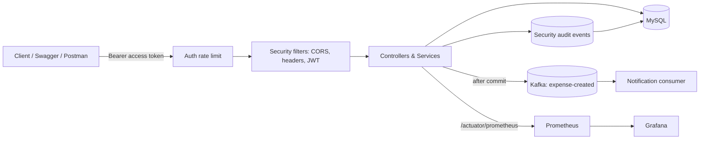

# Expense Tracker API

A production-minded Spring Boot backend for personal expense tracking with secure authentication, owner-scoped APIs, reporting, eventing, and observability.

## Documentation

- [API reference & usage](API.md)
- [Architecture overview](ARCHITECTURE.md)
- [ER diagram](docs/ER_DIAGRAM.md)
- [Design decisions, trade-offs & roadmap](docs/DESIGN_AND_ROADMAP.md)
- [Postman collection](postman/Expense-Tracker-API.postman_collection.json)
- [Demo media placeholders](docs/media/README.md)

## Tech stack

- Java 17 (Spring Boot 3.4, Spring Web, Security, Data JPA, Validation, Actuator)
- MySQL 8, JWT (`jjwt`), Spring for Apache Kafka
- Springdoc OpenAPI (Swagger UI)
- Micrometer + Prometheus, Grafana (provisioned dashboards/datasources)
- JUnit 5 / Mockito, Maven quality gates (Spotless, Checkstyle, SpotBugs, OWASP dependency-check profile), GitHub Actions CI

## Key capabilities

- **Authentication & sessions:** register/login with BCrypt, short-lived JWT access tokens, rotatable/hashed refresh tokens, refresh rotation, logout (single/all devices), and security audit events
- **Security hardening:** stateless security config, defense-in-depth HTTP headers, configurable CORS, in-memory auth rate limiting/brute-force protection, and correlation IDs
- **Expense management:** owner-scoped CRUD, fetch-by-id, filtering (`from/to/categoryId/q`), pagination, and whitelisted sorting
- **Categories & reports:** user categories (create/list/rename/delete), monthly and yearly summaries with breakdowns
- **User profile:** view/update profile and audited password changes (with documented reset considerations)
- **Events & observability:** post-commit `expense-created` Kafka event flow (demo consumer), Actuator health/metrics, Prometheus scrape config, Grafana provisioning
- **Reproducible delivery:** multi-stage `Dockerfile`, Docker Compose app+infra stack, env/profile configuration, CI workflow, and API client collection

## Architecture



More details: [ARCHITECTURE.md](ARCHITECTURE.md) and [docs/ER_DIAGRAM.md](docs/ER_DIAGRAM.md).

## Quick start (one command with Docker)

### Prerequisites
- Docker Desktop + Docker Compose
- A private JWT secret (>= 32 bytes)

### 1) Configure environment
```bash
cp .env.example .env
# edit .env and set JWT_SECRET, DB/Grafana passwords as needed
```
(Windows PowerShell: `Copy-Item .env.example .env`)

### 2) Build and run the full stack
```bash
docker compose up --build
```

This starts **app**, **MySQL**, **Kafka**, **Prometheus**, and **Grafana**. The API is available at `http://localhost:8080`.

- Swagger UI: `http://localhost:8080/swagger-ui.html`
- OpenAPI: `http://localhost:8080/v3/api-docs`
- Health: `http://localhost:8080/actuator/health`
- Prometheus UI: `http://localhost:9090`
- Grafana UI: `http://localhost:3000` (credentials from `.env`; change for non-local use)

Kafka listeners: host clients use `localhost:9092`, containers use `kafka:29092` (preconfigured for the app service).

### Local (host) run without containerizing the app
1. Start dependencies you need (e.g. MySQL and optionally Kafka/Prometheus/Grafana): `docker compose up -d mysql kafka prometheus grafana`
2. Set env vars (see [application.yml](src/main/resources/application.yml), [application-local.yml](src/main/resources/application-local.yml), [.env.example](.env.example)), including `JWT_SECRET`.
3. Run:
```bash
mvn spring-boot:run
# Windows example with an external wrapper:
# .\mvnw.cmd -f "D:\path\to\expense-tracker-api\pom.xml" spring-boot:run
```

## 2-minute happy path demo

1. **Start stack:** `docker compose up --build` and open Swagger at `/swagger-ui.html`.
2. **Register/login:** `POST /api/auth/register` (or `/api/auth/login`) → copy `accessToken` and `refreshToken` from the response.
3. **Authorize:** click **Authorize** in Swagger and paste the access token.
4. **Create data:** `POST /api/categories` (e.g. `{"name":"Food"}`), then `POST /api/expenses` with amount/date/category.
5. **Query & analyze:** `GET /api/expenses?from=...&to=...&q=...&sortBy=amount&sortDir=desc`, `GET /api/reports/monthly?year=YYYY&month=M`, `GET /api/reports/yearly?year=YYYY`.
6. **Profile/security:** `PUT /api/users/me`, `PUT /api/users/me/password` (audited), `POST /api/auth/refresh` (rotation), `POST /api/auth/logout`.
7. **Observe:** check `/actuator/health` and `/actuator/prometheus`, view Prometheus/Grafana, and (with Kafka running) confirm `expense-created` publish/consume logs.
8. **Import collection:** use [postman/Expense-Tracker-API.postman_collection.json](postman/Expense-Tracker-API.postman_collection.json) for repeatable requests.

> Demo captures: add Swagger/Grafana screenshots or GIFs under [docs/media/](docs/media/README.md) (e.g. `swagger-flow.gif`, `grafana-dashboard.png`) and reference them in reviews/presentations.

## API overview

See [API.md](API.md) for full contracts, examples, sorting/filter rules, auth/session lifecycle, and error behavior.

| Area | Key endpoints |
|---|---|
| Auth | `POST /api/auth/register`, `/login`, `/refresh`, `/logout` |
| Profile | `GET/PUT /api/users/me`, `PUT /api/users/me/password` |
| Categories | `GET/POST /api/categories`, `PUT/DELETE /api/categories/{id}` |
| Expenses | `GET/POST /api/expenses`, `GET/PUT/DELETE /api/expenses/{id}` (filters, pagination, sort) |
| Reports | `GET /api/reports/monthly`, `GET /api/reports/yearly` |

## Build, test, and quality gates

```bash
mvn clean test      # unit tests
mvn verify          # tests + Spotless/Checkstyle/SpotBugs checks
mvn -Psecurity-scan org.owasp:dependency-check-maven:check  # advisory dependency scan
```

CI is defined in [.github/workflows/ci.yml](.github/workflows/ci.yml) (build/test/quality checks, JAR artifact, Docker image build) and dependency automation in [.github/dependabot.yml](.github/dependabot.yml).

## Notes

- Demo/capstone scope: schema uses `ddl-auto: update`; prefer migrations, distributed rate limiting, outbox/DLQ Kafka reliability, and deeper integration/security testing for production (see [docs/DESIGN_AND_ROADMAP.md](docs/DESIGN_AND_ROADMAP.md)).
- Configure strong secrets and explicit CORS origins for non-local environments; do not commit `.env`.
- If code/config changes while running, rebuild/restart the app to pick them up (including Swagger docs).
