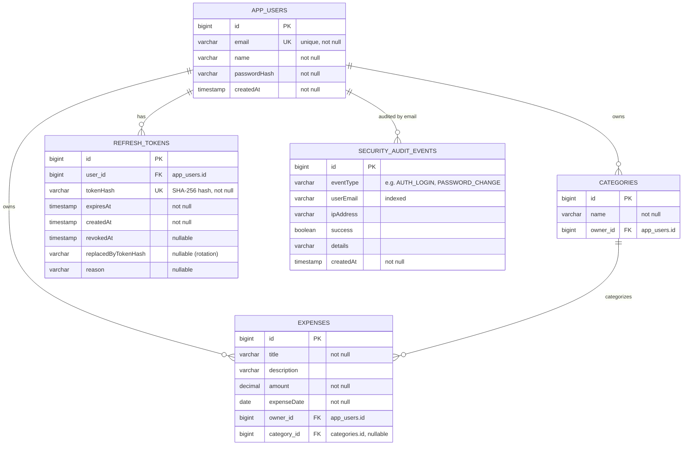

<!-- Copyright (c) 2026 Harsh (git4harsh). All rights reserved. -->
# Entity Relationship Diagram

## Notes

- **Ownership:** expenses and categories are scoped to the authenticated user; repository/service logic enforces owner checks.
- **Categories:** optional on expenses (`category_id` nullable) to allow uncategorized spending.
- **Refresh tokens:** stored as hashes (never plaintext), support expiry, revocation, rotation tracking, and reuse-detection response (revoking active tokens on suspicious reuse).
- **Audit events:** persisted for key security actions (register/login/refresh/logout, profile/password changes) to support monitoring and incident review. Password reset flows are not yet implemented; if added, they should emit audit events for request, token issuance, completion, and failures.
- Schema is currently managed by Hibernate `ddl-auto` for local/dev convenience; production deployments should use versioned migrations (Flyway/Liquibase) with explicit indexes/constraints.
